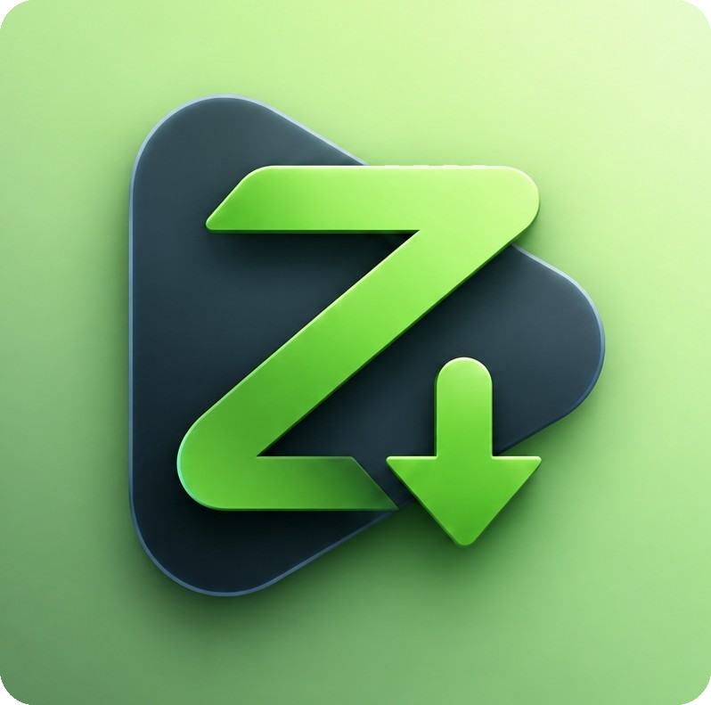
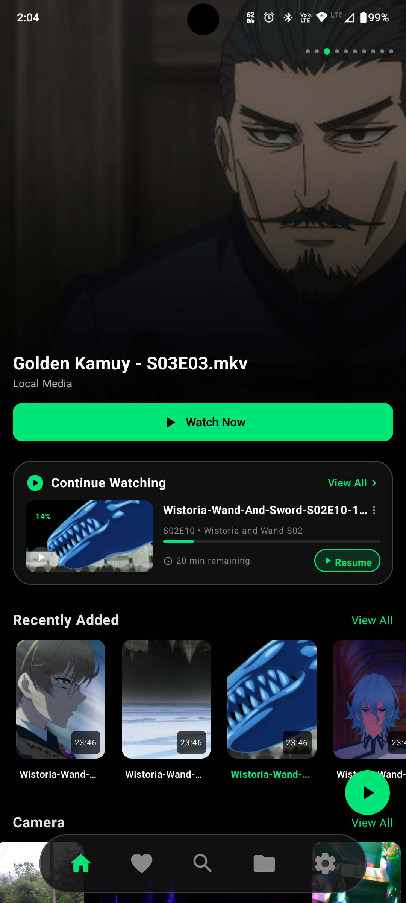
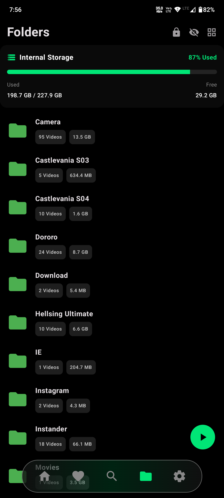
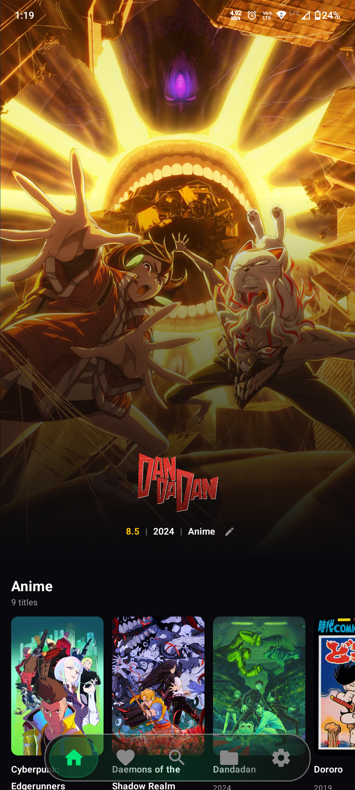
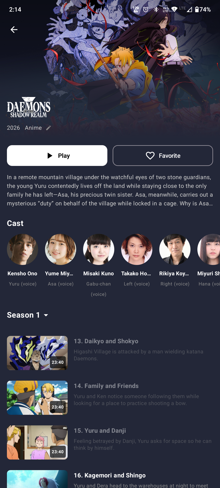
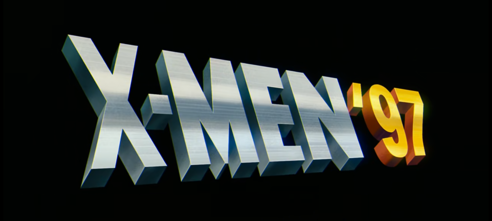
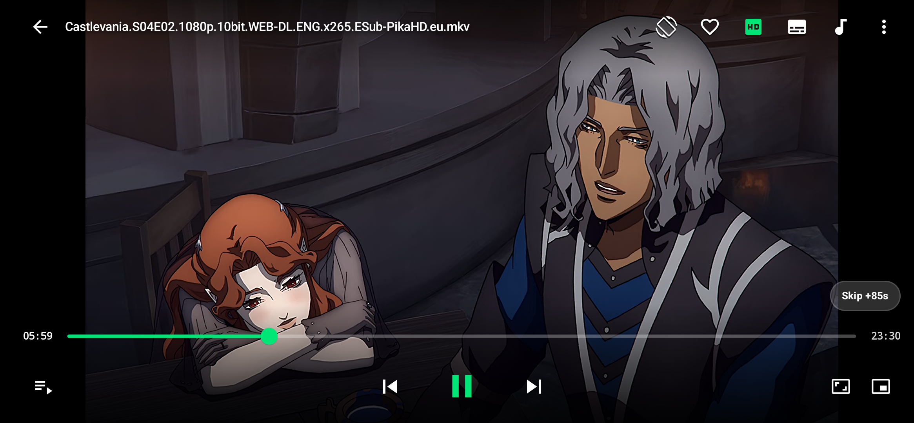
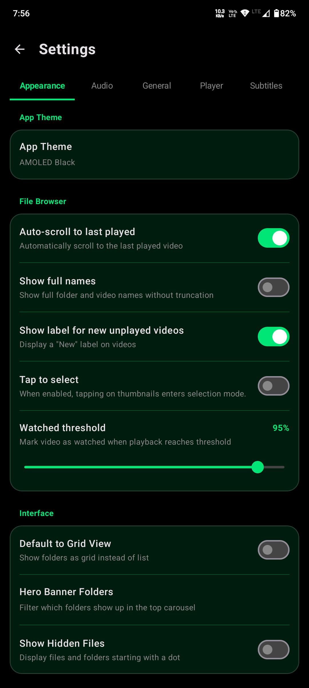
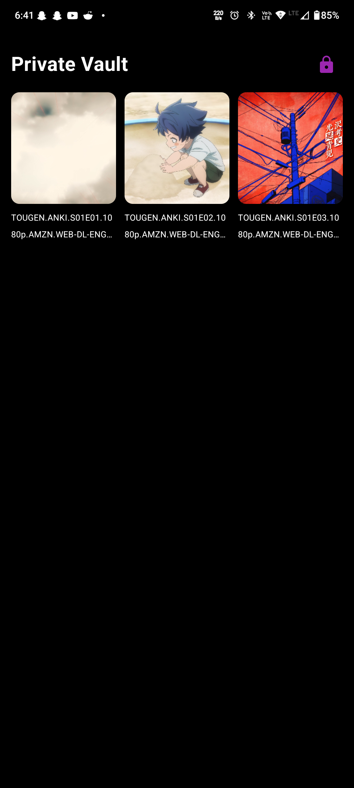

    <h1>Z Player</h1>  

    <strong>Your Media. Your Experience.</strong>
  
  

    A modern, powerful and privacy-focused Android media player designed for your local media.
  
  

    
    
    
    
    
  
  

    <a href="https://github.com/silenTKnight-sudo506/ZPlayer/releases/latest">
      📥 <strong>Download Latest APK</strong>
    </a>
    &nbsp;•&nbsp;
    <a href="#-features">
      ✨ <strong>Features</strong>
    </a>
    &nbsp;•&nbsp;
    <a href="#-screenshots">
      📱 <strong>Screenshots</strong>
    </a>
  

---

📌 Overview

Z Player is a modern Android media player built for people who love keeping their media locally.

Designed to deliver a powerful playback experience without depending on streaming services, accounts, or cloud-based media libraries, Z Player brings your videos and audio files together in one place.

Powered by libmpv and built with Kotlin, Jetpack Compose, Material 3, and Room, it combines a modern interface with a flexible playback engine and a feature-rich media library.

Whether you're watching movies, following your favourite anime, or organizing your personal video collection, Z Player gives you the tools to enjoy your media your way.

No subscriptions. No mandatory accounts. Just your media.

---

✨ Features

🎬 Powerful Media Playback

Enjoy a flexible playback experience powered by libmpv.

- libmpv-powered playback engine
- Wide media format and codec compatibility
- Multiple audio track support
- External and embedded subtitle support
- Adjustable audio and subtitle delay
- Automatic playback progress saving
- Resume playback from where you left off
- Next and previous media navigation
- Intro and outro skipping
- Custom playback speeds
- Picture-in-Picture support

🌀 Anime4K Video Enhancement

Give your anime a visual upgrade with Anime4K real-time upscaling.

- Anime4K-based video enhancement
- Real-time video upscaling during playback
- Enhanced anime viewing experience
- Integrated with the libmpv playback pipeline

Availability and performance depend on the selected enhancement configuration and device hardware.

🎛️ Advanced Playback Controls

Take control of every aspect of your playback experience.

- Smooth and precise seeking
- Brightness and volume gestures
- Playback speed adjustment
- Multiple aspect ratio options
- Audio track selection
- Subtitle track selection
- Subtitle synchronization and delay adjustment
- One-handed playback controls
- Intuitive playback gestures

📚 Smart Media Library

Keep your entire local media collection organized and accessible.

- Continue Watching – Quickly resume unfinished videos and episodes.
- Recently Added – Discover newly scanned media.
- Folder Browsing – Browse videos through your device's directory structure.
- Background Scanning – Automatically discover local media.
- Playback History – Keep track of previously watched content.
- Favorites – Save your favourite videos for quick access.
- Playlists – Organize your media into personalized collections.
- Hidden Files & Folders – Access hidden media when needed.
- Customizable Navigation – Configure your library navigation experience.

🌐 Online Integrations

Enhance your local media library with online metadata, artwork, and anime categorization.

🎬 TMDB Integration

- TMDB-powered home screen
- Movie and TV show metadata
- Detailed media information and artwork

🎌 AniList Integration

- Anime identification and categorization
- Anime-focused media organization
- AniList-powered anime metadata

«Note: Z Player follows an offline-first approach. Online integrations such as TMDB and AniList require an active internet connection. To keep the core experience focused on local media, these integrations are disabled by default. You can choose whether to enable them based on your preference.

To enable online integrations, go to Settings → General → Rich Metadata (TMDB).»

🎨 Modern Material 3 Interface

A clean and thoughtfully designed interface that feels at home on Android.

- Jetpack Compose-based interface
- Material 3 design
- Card-based media browsing
- Hero preview banners
- Adaptive system theming
- Android Dynamic Colors
- Light and dark themes
- Clean and minimal navigation
- Responsive layouts for phones and tablets

🔐 Privacy & Security

Your personal media deserves privacy.

- Local-first architecture
- No account required
- No mandatory cloud media library
- Private Vault – Keep selected media separate from your regular library.
- Vault Lock – Protect your private collection.
- App Lock – Add an additional layer of application security.
- Local playback history and progress storage

⚙️ Additional Tools

Small conveniences that make the overall experience better.

- 🔎 Settings Search
- 📖 Built-in User Guide
- 🌍 Multiple language support
- 💾 Storage information
- Customizable playback settings
- Configurable media library preferences

---

🚀 Powered by libmpv

At the heart of Z Player is libmpv, a powerful and flexible media playback engine.

Rather than relying on a basic playback implementation, Z Player uses libmpv to provide advanced media handling and playback capabilities.

This enables:

- Broad media format and codec compatibility
- Advanced audio and subtitle handling
- Playback speed control
- Flexible aspect ratio management
- Subtitle synchronization
- Advanced playback configuration
- Video enhancement capabilities

The result is a playback experience designed to handle everything from everyday videos to high-quality anime and movie collections.

---

📱 Screenshots

🏠 Home & Media Library

  
  

🎬 TMDB Integration

  
  

▶️ Video Player

  

  

⚙️ Settings & Privacy

  
  

📥 Installation

Getting started with Z Player is simple.

1. Visit the "Latest Releases" (https://github.com/silenTKnight-sudo506/ZPlayer/releases/latest) page.
2. Download the appropriate APK for your Android device.
3. Install the downloaded APK.
4. Launch Z Player and grant the required media permissions.
5. Start enjoying your local media!

### APK Architectures

| APK | Architecture | Recommended For |
|---|---|---|
| **arm64-v8a** | 64-bit ARM | Most modern Android phones and tablets |
| **armeabi-v7a** | 32-bit ARM | Older ARM devices |
| **x86_64** | 64-bit x86 | x86_64 Android devices and emulators |
| **x86** | 32-bit x86 | Older x86 devices and emulators |
| **Universal** | Multiple architectures | Recommended if you're unsure |

---

🛠️ Technology Stack

Z Player is built using modern Android technologies.

Technology| Purpose
Kotlin| Primary programming language
Jetpack Compose| Declarative UI development
Material 3| Modern Android design system
libmpv| Media playback engine
Room| Local database and persistence
Android SDK| Native Android platform integration

---

🔒 Privacy

Z Player follows a local-first approach to media management.

Your videos, audio files, playlists, favorites, playback history, and resume progress are stored locally on your device.

Z Player does not require an online account or cloud-based media library for its core functionality.

Your media stays yours.

---

📄 License

Z Player is distributed under the GNU General Public License v3.0.

See the "LICENSE" (LICENSE) file for license details.

---

⭐ Enjoying Z Player?

If you enjoy using Z Player, consider giving the project a ⭐ Star on GitHub.

Your support helps the project reach more Android users and motivates continued development.

 Your Media. Your Experience.

Made with ❤️ by "silenTKnight" (https://github.com/silenTKnight-sudo506)

